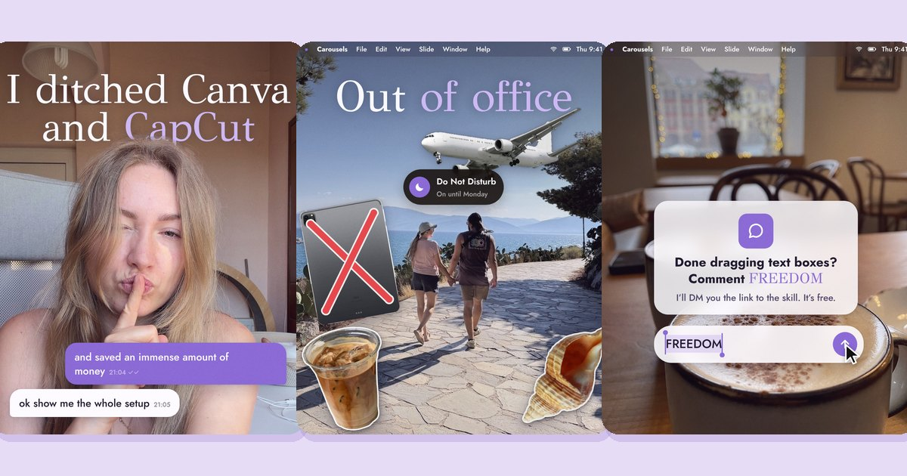
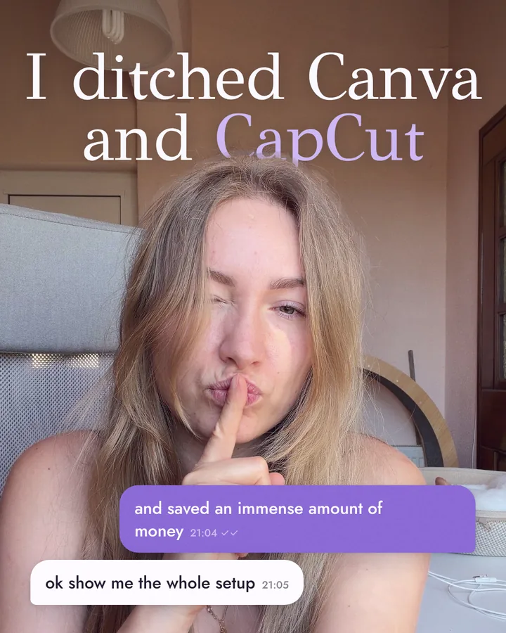
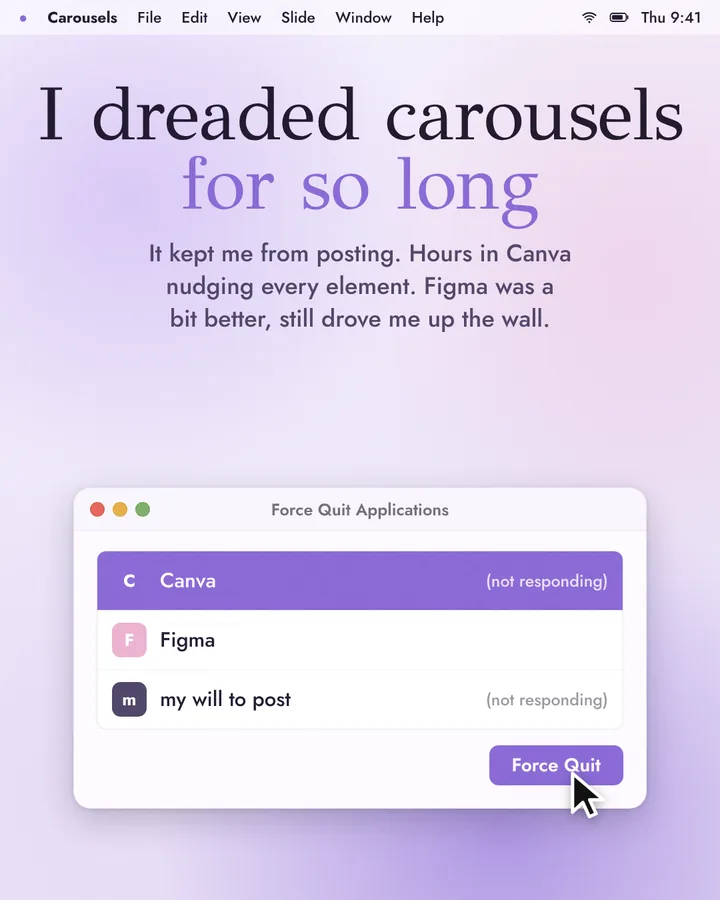
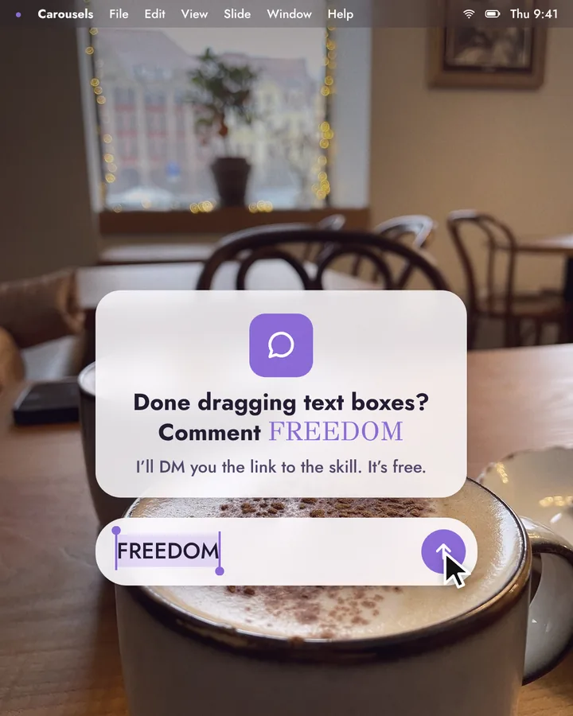

<div align="center">

# Carousels

**Turn your own photos into Instagram carousels by talking to Claude.**

A free, open-source skill for Claude Code by [@codecoffeechaos](https://www.instagram.com/codecoffeechaos/).
Mac (recommended) or Windows.

[Guide and live example](https://cyberspell.tech/carousel-skill/?utm_source=github&utm_medium=readme) ·
[Install](#install-step-by-step) ·
[Cheat sheet](CHEATSHEET.md)



</div>

Drop your photos in a folder, type `/carousels`, answer a few questions. Claude cuts you out of your photos, puts titles
and macOS-style windows behind your head, grades every photo to one look and renders the slides: 1080×1350 PNGs in
order, plus a PDF. You change anything by saying it.

## What you get

| | |
|---|---|
| **Ready to post** | 1080×1350 PNGs numbered in order, a PDF, and a preview of all slides side by side |
| **You, cut out** | Titles, chat bubbles and windows can sit behind you. No masking by hand |
| **One look for every photo** | Random phone photos get one color grade, so they read like one shoot |
| **Your fonts and colors** | Any font on your computer, a font you bought, or a free one. Your hex codes, or colors pulled from your inspo |
| **Your own stickers** | Drop PNGs in a folder; white backgrounds get cut out, add a sticker outline or a big red X |
| **Edits by talking** | "Make slide 3 a list." "Swap 2 and 4." "Warmer photos." Only what changed re-renders |
| **Help with the words** | A short brief, hook options, a slide plan and a draft in your voice, if you want one |

## Example

<table><tr>
<td></td>
<td></td>
<td></td>
<td></td>
</tr></table>

All twelve slides, swipeable: [cyberspell.tech/carousel-skill](https://cyberspell.tech/carousel-skill/?utm_source=github&utm_medium=readme&utm_content=example)

## Install, step by step

You need a Mac with Apple Silicon (recommended) or a 64-bit Windows 10/11 PC, a Claude plan that includes Claude Code
(Pro or Max, or a Team or Enterprise seat with it), and about 2 GB of free space.

1. **Install Claude Code and sign in.** Follow the [official guide](https://code.claude.com/docs/en/overview). On
   Windows, also install [Git for Windows](https://git-scm.com/downloads/win).
2. **Open Terminal or PowerShell.**
   Mac: press `Cmd` + `Space`, type *Terminal*, press Enter.
   Windows: click Start, type *PowerShell*, open *Windows PowerShell*.
3. **Paste the install command and press Enter.** Wait until you see **READY** (a few minutes).

   Mac:
   ```bash
   curl -fsSL https://cyberspell.tech/carousel-skill/install.sh | bash
   ```
   Windows (PowerShell):
   ```powershell
   irm https://cyberspell.tech/carousel-skill/install.ps1 | iex
   ```
   Something missing? The installer tells you exactly what and how to fix it. Running it again is always safe.
4. **Start Claude Code in your Carousels folder.** The installer made a `Carousels` folder in your home folder.
   In the same window type `cd ~/Carousels`, press Enter, then `claude`. Or open the *Code* tab in the Claude desktop
   app and choose the *Carousels* folder. Had Claude Code open already? Restart it so it sees the new skill.
5. **Type `/carousels`.** The brief starts. When Claude asks to run a command, allow it: that's the skill preparing
   your photos and rendering slides on your computer.

**Rather not use Terminal?** Download this repo as a zip (green *Code* button → *Download ZIP*), unzip it, open the
folder in the *Code* tab of the Claude desktop app and type: *Run the installer in this folder and tell me when it says
READY.* Then go on to step 4. Details in [INSTALL.md](INSTALL.md).

## The folder system

Claude creates these after the brief and opens them for you. Fill what you have, skip what you don't. Only the photos
are a must.

```
Carousels/
  _brand/                        your handle, colors, fonts, photo look (made once, used by every carousel)
  One notebook runs my whole week/   one folder per carousel, named after its hook
    1-style-inspo/               screenshots of the look you like (Pinterest is perfect for this)
    2-reference-carousel/        one carousel you'd love yours to feel like, every slide in order
    3-photos/                    your photos and short videos, straight from your phone   ← must
    4-assets/                    stickers, logos, icons: PNG with a transparent or plain white background
    5-script/script.md           your text, rough notes, or nothing yet
    brief.md                     written by Claude in the brief: hook, reader, CTA, slide plan, look
    final/                       01.png, 02.png… to upload in order, plus carousel.pdf
```

Claude takes the *system* from your references (layout, type, rhythm, photo treatment), never someone else's logo,
brand marks or signature graphics.

## Your first carousel

1. **Type `/carousels`.** One or two questions at a time: what it's about, who it's for, what they should do at the end.
2. **Pick your hook and structure.** Bring your own hook or choose from three. Then a structure: story, steps, tips,
   before and after, myth vs truth, or a photo dump.
3. **Fill your folder** and say **ready**.
4. **Set your look, once:** handle, colors, fonts, photo look, macOS mockups or clean slides. Or start from the
   ready-made **lilac** look from the example.
5. **Approve the slide plan:** every slide's job, text, photo and layout. Then the text gets written or polished in
   your voice.
6. **See it, change it by talking.** Only the slides you change re-render.
7. **Post, and tag [@codecoffeechaos](https://www.instagram.com/codecoffeechaos/)** on a slide or in the caption, so
   I can see what you made.

## Make it yours

- **Fonts:** any font installed on your computer (just say its name), a font file you bought, a free Google Font, or
  the built-in free set. Not sure? Claude shows three pairs on a test slide.
- **Colors:** your hex codes, or pulled from your Pinterest inspo, shown as swatches first.
- **Photo look:** warm, neutral, cool, film or black and white; grain from none to strong.
- **Mockups:** chat bubbles, pop-ups, notifications, windows, a terminal, a Finder view, a profile card. In front of you
  or behind you, or clean slides with none.

## Things you can say

| say | what happens |
|---|---|
| "cover on the coffee photo, title behind my head" | a cover with the title tucked behind you |
| "a chat bubble on the right: …" | an iMessage-style bubble, placed off your face |
| "a pop-up asking …, buttons Later and Show me" | a macOS-style dialog |
| "put that window behind me" | the window shows around you, not over you |
| "put the coffee from assets bottom left, with a sticker outline" | your file on the slide, white sticker edge |
| "swap 2 and 3" · "delete 7" · "add a slide after 4" | new order, slides renumbered |
| "warmer photos" · "no grain" | a new grade on every photo |

More in [CHEATSHEET.md](CHEATSHEET.md).

## Where it breaks

- **Busy backgrounds:** hair the same color as your wall, or a cluttered room, confuses the cut-out. Shoot against
  something plain.
- **No space above your head:** the cover title needs about a third of the frame above you.
- **Tiny assets:** a small PNG gets blurry when it's scaled up. Use files at least 1000 px wide.
- **Very long titles:** they shrink to a minimum size, then need to be shorter.
- **Best on a Mac:** it runs on Windows too, but cutting out photos is slower without an NVIDIA graphics card, and Mac
  fonts like Didot and Futura get free stand-ins. Intel Macs and Windows on ARM aren't tested.
- **Pinterest and Instagram:** Claude doesn't download from them. You save screenshots into your folders.

## Privacy

Your photos stay on your computer: the cut-out, grading and rendering run locally with free, open-source models. When
Claude looks at a preview, a photo or your inspo to check its work, that image is sent into your conversation with
Claude.

The installer sends one anonymous count at the end (installed, or the step that failed, plus Mac or Windows) so I know
whether installs work. No personal data. To skip it, set `CAROUSELS_NO_STATS=1` before running it.

## Uninstall

```bash
bash ~/.claude/skills/carousels/install.sh --uninstall
```
On Windows: `powershell -ExecutionPolicy Bypass -File "$HOME\.claude\skills\carousels\install.ps1" -Uninstall`.
It deletes `~/.claude/skills/carousels` and `~/.carousels`. Your `Carousels` folder with your work stays.

## What's in this repo

| path | what |
|---|---|
| `SKILL.md` | instructions for Claude: the brief, folders, engine commands, checks |
| `references/` | the kickoff brief, writing rules for carousels, brand kit guide |
| `template/` | the folders Claude copies for your brand kit and each carousel |
| `engine/` | Python + HTML/CSS: photo prep, cut-out, layouts, UI mockups, rendering |
| `install.sh`, `install.ps1` | installers for Mac and Windows (`--doctor` / `-Doctor` checks everything) |
| `CHEATSHEET.md` | what you can say |

## License

GPL-3.0, see [LICENSE](LICENSE). Third-party parts and their licenses are listed in [NOTICE.md](NOTICE.md): the
cut-out model (RobustVideoMatting, GPL-3.0) and the pose model (MediaPipe, Apache-2.0) download during install from
their official sources; fonts in `engine/templates/fonts/` are under the SIL Open Font License.

Questions or a bug? Open an issue here or DM [@codecoffeechaos](https://www.instagram.com/codecoffeechaos/).
